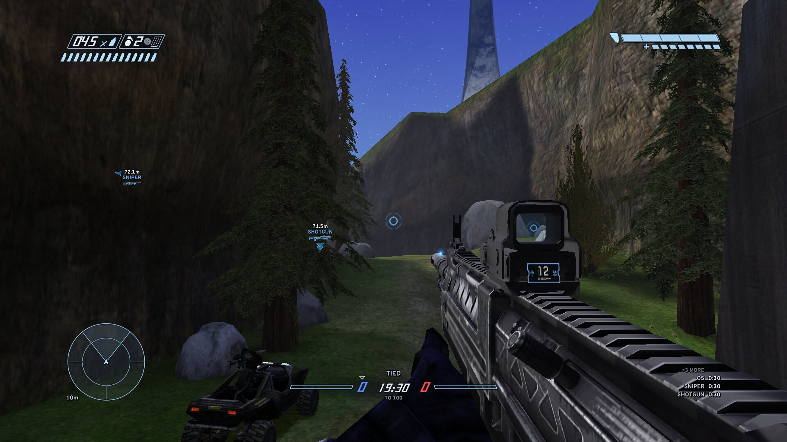
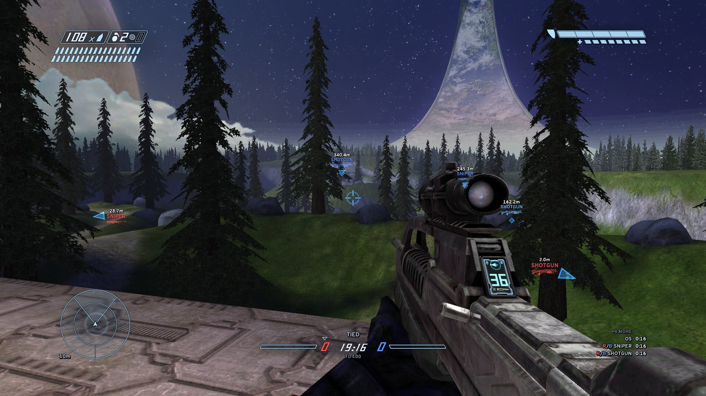
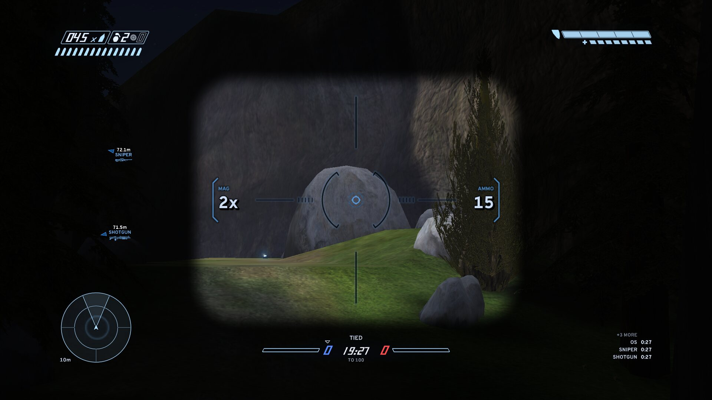
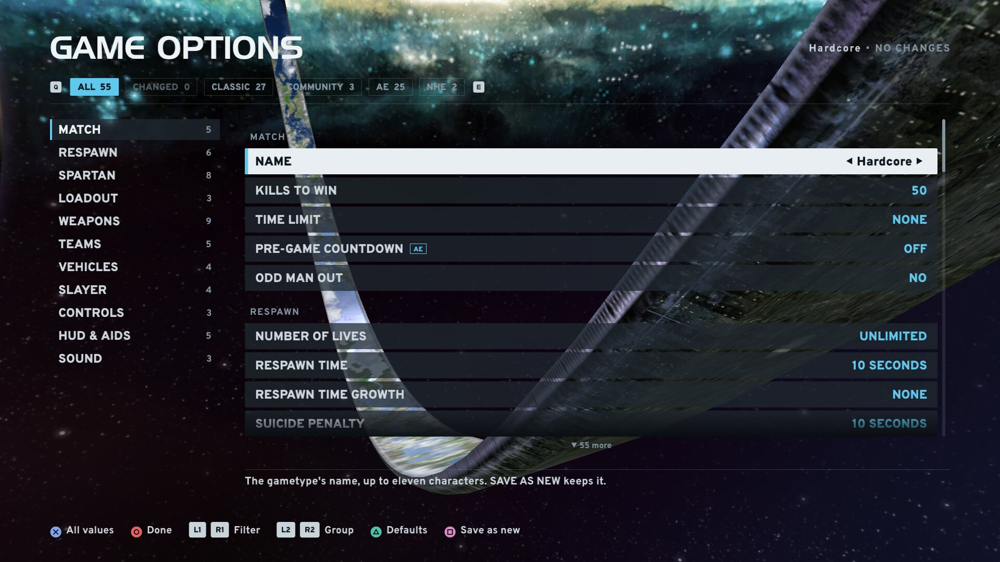
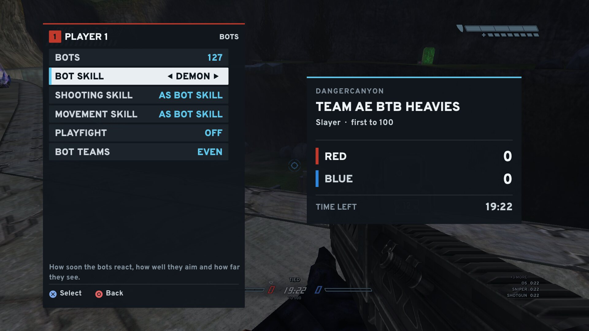

<h1 align="center">
  <picture>
    <source media="(prefers-color-scheme: light)" srcset="port/assets/branding/readme-banner-light-1280x320.png">
    
  </picture>
</h1>

<b>Halo: Combat Evolved with modern quality of life, on any PC. Every addition optional, CE's balance kept.</b>

  <a href="https://peterrichardsongolf.github.io/Halo-CE-Arena-Evolved/"><b>Website</b></a> ·
  <a href="https://github.com/PeterRichardsonGolf/Halo-CE-Arena-Evolved/releases/latest"><b>Download</b></a> ·
  <a href="https://quiverlauncher.com/apps/halo-combat-evolved-halo-ce-arena-evolved"><b>Get it with Quiver</b></a> ·
  <a href="docs/how-to-play.md"><b>How to play</b></a> ·
  <a href="docs/host-a-server.md"><b>Host a game or server</b></a>

Arena Evolved (AE) is a non-commercial fan project that runs Halo: Combat Evolved's Xbox engine natively on
modern computers. It is a fork of [OpenCE](https://github.com/OpenCommunityEdition/OpenCE), the port of the Halo:
Combat Evolved decompilation, and grew from [ChupathingyCE](https://github.com/ChupathingyCE/chupathingyce). Its focus:

- **Modern quality of life:** what later games made standard (item timers, a match clock, bots, split screen with
  each player's own profile and settings, map downloads from the host, menus that work with any controller or a mouse
  and keyboard), and fixes for the annoyances the game has always had.
- **New gameplay:** new gametypes, weapons and vehicle features, tuned to fit Halo CE's sandbox rather than replace it.
  The magnum stays the magnum; a new weapon earns its place against Halo CE's own.

**Why Arena Evolved?** OpenCE is the port itself, and Arena Evolved builds on it. Our aim is one place where every
Halo player can sit down and play CE together: people who played it on LAN in 2002 and people who grew up on the newer
games. So it keeps CE's classic competitive game and adds what players expect today. If you own Halo: The Master
Chief Collection on Steam, that's all you need: Arena Evolved finds it and plays CE straight from MCC's own files,
Workshop maps included. No disc image, nothing to convert. Many of its ideas come from other
community projects, credited below. Halo CE is still played because its community kept it going; this is our part.
[Halo 1: NHE](https://halo1nhe.com/)'s own maps and gametypes stay supported as an option.

> **Status: beta, in active development.** Supported and tested with every release: **Windows and Linux**. macOS on
> Apple silicon is built with every release. Android and the other platforms OpenCE builds come from the same code and
> are attached untested.

  

<table>
  <tr>
    <td width="50%"> Timberland, from MCC's files, with the battle rifle</td>
    <td width="50%"> The EVO RIFLE's scope shows its zoom and the rounds loaded</td>
  </tr>
  <tr>
    <td> GAME OPTIONS: every rule of a gametype, in groups</td>
    <td> Bots added or changed mid-game, from the pause menu</td>
  </tr>
</table>

This repository holds the releases and the issue tracker. Development happens elsewhere; each release's complete source
is attached to it.

## What's in it

- **MCC maps and Workshop mods, online:** play Halo: The Master Chief Collection's Halo CE maps and the Workshop maps
  you subscribe to with other players. MCC has no server browser for modded custom games; Arena Evolved does: host from your
  own install, find games in the server browser or on your LAN, or join by address. Players joining a Workshop map
  need the same Workshop item, and the game tells them which one. Workshop maps are hosted from a player's own game;
  dedicated servers serve the stock and Custom Edition maps.
- **Online and LAN:** server browser, LAN search, invite links, JOIN BY ADDRESS (an IP or a
  computer's name, with a recent list), dedicated servers for Linux, text and voice chat. Custom Edition and community maps you lack come
  from the host as you join, with its layout. OFFLINE games on one PC pause for real. Plays with OpenCE builds that share its network version.
- **Bots** in six levels from RECRUIT to DEMON, up to 31 on one PC and 127 in a game you host, in every mode: a wingman
  per player, squads that flank, flag crews that escort, bombers that carry, plant and defend. They drive and ride
  vehicles, know the power items' timers, dodge rockets, take revenge, and stay out of your line of fire. A bot steps
  aside when a player joins. PLAYFIGHT bots aim but never shoot, for practice.
- **Split screen on PC:** up to four players on one PC, locally, on a LAN and online, each with their own profile,
  controller layout, settings and pause menu; a controller picker sorts four pads fast.
- **Search and Destroy and Bomb, AE's round modes:** one life a round, a real bomb carried on the back, held to pick
  up, a fuse timer on its face, a blast that hurts by distance; only the attackers hear about it. Built on the
  ChupathingyCE team's Bomb engine. Grifball, their original mode too, is in ACTION SACK and still a work in progress.
- **Weapons tuned to Halo CE's sandbox:** the battle rifle (bursts, 3x), the EVO RIFLE (single shot, tuned for competitive
  play, a 2x scope with its zoom and rounds live), the DMR (steady marksman rifle), SMG, carbine, and suppressed SMG and
  AR, as weapon packs that work on stock, Custom Edition and MCC maps. Each pack turns on or off in a gametype's GAME
  OPTIONS, and a gametype picks what you start with.
- **Ready-made gametypes in playlist folders:** AE FFA, 2V2, 4V4 (casual and COMP), BTB (big team, with heavy-vehicle
  versions), OBJECTIVE (Search and Destroy, Bomb), ACTION SACK (Phantoms, Juggernaut, Stalker, Crazy King, Elimination,
  Race, Rally, Grifball, SWAT, Snipers, Rockets, Shotguns and more), PRACTICE with OCTAGON warm-up drills; Halo 1: NHE's
  gametypes as an option.
- **Rules you can set on any map,** each a row in GAME OPTIONS: fall damage, health styles, COMBAT FEEDBACK (shield pop, recharge, blood pop), no spread, a pre-game countdown, MELEE
  UNZOOMS, controller crouch, mouse aim assist, silent movement and weapons for split screen, destructible vehicles,
  friendly splatter, lethal oddball, practice mode, and SPAWNS CLASSIC or MODERN.
- **Training aids:** item timers and waypoints with pictures, spawn markers and spawn heat, spoken callouts in seven
  voices (three detail levels), a match clock, dead ally markers, a green ally reticle, an enemies-only motion sensor.
- **Host tools:** RESTART GAME and RESTART ROUND, bots and skill changed mid-game, CHANGE MAP and GAME OPTIONS from the
  pause menu, SHUFFLE TEAMS, teams pinned for bots, a gametype changed between games without leaving the lobby.
- **Controllers:** many button layouts including MCC's, DualSense adaptive triggers (a profile per weapon) and lightbar, back
  paddles, Nintendo and PlayStation prompts, gyro aiming, stick deadzones. Mouse and keyboard: KEY BINDINGS, wheel
  zoom, hold-to-zoom and MCC-style sensitivity.
- **Menus built from scratch for today's PCs:** fast and controller-first, just as good with a mouse and keyboard, and
  sized for anything from a handheld to an ultrawide. A live CREATE GAME lobby with MY PARTY, where friends and bots
  join as you set up. CHANGE MAP and CHANGE GAMETYPE browse folders (STOCK, MCC, WORKSHOP, map packs) with map pictures,
  search, favourites and RECENT. Its own pause menu, scoreboard and post-game, and every setting explained in a line of
  help.
- **HUD and display:** a modern, competitive combat HUD of its own (or Halo CE's) with a score strip, a frame-rate limit you type (30 to
  1000), a performance line with ping, HUD area and compact HUD, backpack weapons on bodies, pistol colour.
- **Capture:** screenshots (every split view) and video recording with sound (Windows includes FFmpeg).
- **Map packs and layouts:** community, Custom Edition and modded-disc maps keep their own folders and pictures;
  layout files let a pack move, add and remove items, vehicles, spawns and flags, and set a map's jump.
- **Updates and privacy:** the game checks this page for a signed release and asks first (AUTO UPDATE turns it off).
  Public game lists, stats and crash reports stay off unless you turn them on.
- **For map makers and testers:** layout logs, SHOW COORDINATES, a dev camera, a TEST RUN list runner.

## Play it stock if you want

Nothing Arena Evolved adds is forced on you:

- **Halo CE's own gametypes play by Halo CE's rules.** The AE rules (weapon packs, health styles, no fall damage,
  MODERN spawns and the rest) are on only in the AE gametypes, and each is a row you can switch off. As the host, your
  gametype decides for everyone in the game.
- **Halo CE's look:** HUD STYLE CE draws the game's own HUD, Settings > System > MENUS brings back the PC version's
  menus, and callouts, timers, waypoints and the other aids each have their own setting.
- **Classic menus hide AE's screens.** Most of Arena Evolved's screens exist only in its own menus: the pause menu and
  post-game, CREATE GAME's live lobby and MY PARTY, CHANGE MAP's MCC, WORKSHOP and pack folders, search and favourites, JOIN BY
  ADDRESS, KEY BINDINGS, RESTART GAME and RESTART ROUND, and the gametype editor's full GAME OPTIONS. With the classic
  menus on, those are gone (the gametypes' rules still play). Switch MENUS back to use them.
- **Stock maps stay stock:** the STOCK folders hold the game's own maps as they shipped, from your disc image or MCC.
- **Play with classic clients:** online, Arena Evolved plays with OpenCE builds that share its network version, so
  classic and AE players can meet in one game.

## Download

Take the zip for your system from the [Releases](../../releases) page:

| Download | For |
| --- | --- |
| `arena-evolved-<version>-windows64.zip` | Windows 10 or 11, 64-bit, with OpenGL 4.5. Nothing to install. |
| `arena-evolved-<version>-linux64.zip` | Linux x86-64, most distributions (Ubuntu 22.04 and later, Mint, Zorin, Pop!_OS, Debian 12), SDL3 included. |
| `arena-evolved-<version>-linux64-arch.zip` | Arch and other rolling distributions (uses the system's `sdl3`). |
| `arena-evolved-<version>-macos.tar` | macOS 13 or later on Apple silicon. |
| `-android-unsigned.zip` | Android 9 or later on 64-bit ARM, untested. |
| `-server-linux-<arch>.zip` | The dedicated server. |

Only the latest release is kept here.

Or get it with Quiver: [Arena Evolved on Quiver](https://quiverlauncher.com/apps/halo-combat-evolved-halo-ce-arena-evolved).

## You need your own copy of the game

Arena Evolved includes none of the game's maps, sounds or art. It plays from either of these, or both:

- **Halo: The Master Chief Collection on Steam.** Install MCC with both of its Halo CE pieces of content (Steam's DLC
  list): **Halo: Combat Evolved Anniversary** and **MCC - H1: Multiplayer**. Arena Evolved finds the install by itself
  and plays its Halo CE multiplayer maps and the Halo CE maps of every Steam Workshop item you subscribe to, straight
  from MCC's own files. No disc image needed and nothing is converted.
- **A disc image you made from your own Xbox disc** of Halo: Combat Evolved (`.iso` or `.xiso`, any region). Not
  needed for MCC's maps. It adds crossplay with players who don't have MCC (such as OpenCE players), the original Xbox
  maps, and the community's maps and mods made for the original Xbox version. The first time it starts, the game asks
  for the image and copies its maps out of it (about 2 GB).

Use only a copy of the game you own. Arena Evolved never provides, links to or helps find game files, and issues asking
for them are closed.

With both, you get the disc's maps and MCC's in one list. Settings > MAP FILES turns MCC's files off or picks its
folder.

## Getting started

1. Start the game. With MCC installed on Steam (both pieces of Halo CE content), it finds MCC and opens the menus.
   Without it, it asks for your Xbox disc image the first time.
2. The menus are Arena Evolved's own (Settings > System > MENUS switches to the PC version's). The game's settings are
   under SETTINGS, each with a line of help; a gametype's rules are in its GAME OPTIONS.
3. MULTIPLAYER > CREATE GAME. A new lobby starts OFFLINE (this PC only); NETWORK picks LAN or HOST ONLINE. Pick a map
   and an AE gametype, and set the lobby's BOTS. Extra players on this PC press START on their controllers in the
   lobby.

## Playing over LAN

Every computer needs to be on the same network (not a guest Wi-Fi) with UDP ports **5150**, **5151** and **5160**
and TCP port **5153** open. Windows asks the first time the game starts: allow it. On Linux a firewall blocks LAN
games silently: open the ports once (`sudo ufw allow 5150:5151/udp`, `sudo ufw allow 5160/udp`,
`sudo ufw allow 5153/tcp`). A VPN can hide your game from the network: turn it off to host. Players who lack the
host's Custom Edition or community maps get them from the host as they join.

## Where it's going

More of the same focus: quality of life and the old annoyances ironed out, new gameplay that respects Halo CE's
balance, and bots good enough to fill any game. Next: a first start that walks MCC players through anything missing,
player guides, more vehicles, custom controller layouts, and the newest OpenCE builds merged in.

## Source and licence

Arena Evolved is free software under the GNU Affero General Public License, version 3 or (at your option) any later
version (`AGPL-3.0-or-later`). It comes with no warranty. Parts from ChupathingyCE 0.8.0 and later keep their GPL-3.0
terms.

**Source:** every release has a source tarball asset, the complete source of that release. Third-party code, fonts and
art keep their own licences, which are beside them in the tarball and in the downloads.

The ORBIT logo and the ARENA EVOLVED wordmark are all rights reserved by the project. You may use them unmodified to
refer or link to Arena Evolved, but not as another project's branding.

## FFmpeg

The Windows download includes an unmodified FFmpeg static build (`ffmpeg.exe`, GPL v3) for recording, with its licence
and `FFMPEG-SOURCE.txt`, which says where its source is. Deleting `ffmpeg.exe` turns recording off; screenshots still
work. On other systems, recording uses your own FFmpeg.

## Issues welcome

Bug reports and ideas are welcome in [Issues](../../issues). For a bug, please include:

- your system and the AE version (it is in the window's title);
- what you did and what you saw;
- `debug.txt` from the game's folder, if you can.

## Credits

**Bungie**, who made Halo: Combat Evolved in 2001: the game all of this exists to keep playing. Thank you.

**The map makers and modders** of the last twenty-plus years: your maps, mods and Workshop items are why there is still
so much to play. Arena Evolved shows them with their own names, pictures and credits.

**Upstream.** Arena Evolved is built on their work, and everything below came with it:

- [punpckhdq/halo](https://github.com/punpckhdq/halo) and [bnunu/halo-1](https://github.com/bnunu/halo-1), the code
  of the Xbox build 2342 that the port grew from.
- [OpenCE](https://github.com/OpenCommunityEdition/OpenCE) and its contributors (its main contributors are Jonas
  Volman, bnunu and MrBruh), including the libraries SDL3, stb, Mbed TLS, miniupnpc, KCP, tomlc17, musl's maths, Expat,
  Monocypher, zlib, SMAA, opus, jsmn and bcdec, the Overpass font (SIL OFL), lucide icons, pugzysixtyfour's mouse
  cursor, and streamer mode's word list (Surge AI's "The Obscenity List", MIT, and the public-domain english-words).
- [ChupathingyCE](https://github.com/ChupathingyCE/chupathingyce): Milenko and contributors. Their work includes the
  Bomb engine and Grifball; the high-res HUD from Aerocatia's and Jessie's
  [Halo PC Restored](https://github.com/Aerocatia/halopc-restored) art, used with Aerocatia's permission; Kenney's input
  prompts (CC0), snapchipper's controller icons (CC0), fizzy's Cyborg Interface Gothic, Noto Sans (SIL OFL), Project
  Nayuki's QR Code generator, the scoreboard's platform marks (Simple Icons, CC0, and Wikimedia Commons), the HaloMD
  map names from MacGamingMods' list, and ugoboom's (Zebouski) HD HUDs on Custom Edition maps.

**Arena Evolved's own additions use:**

- [GulchCE](https://github.com/chestahh/GulchCE): the MCC map loading builds on its work (CC0).
- CMT: the rifles' and the vehicle damage pack's models, sounds and effects, and the vehicle horn, from the source
  release of The Silent Cartographer: Evolved, used with credit.
- CuiGames: the EVO RIFLE's sight. [Kenney](https://kenney.nl): the DMR's reticle base (CC0).
- The callout voices: made for Arena Evolved with Qwen3-TTS (Apache-2.0) and released under CC0. Cori is a clone of
  Cori Samuel's public-domain LibriVox reading; the other six are voices designed from a text description.
- [Halo 1: Neutral Host Edition](https://halo1nhe.com/): the NHE team, whose competitive rules inspired AE. AE's versions
  are its own code, and AE is not made or endorsed by the NHE team.

The full list and every notice are in each release's download and source tarball.

## Legal

Halo is a trademark of its owner. Halo CE: Arena Evolved is a non-commercial fan project, not made or endorsed by the
game's owners or developers, and includes none of the game's content. It must never be sold.
